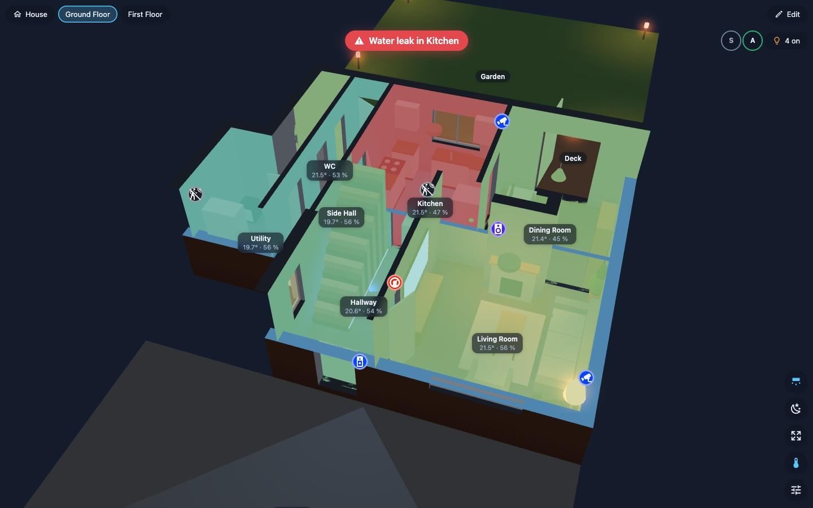

# VirtuHome

Your home as a live 3D model in Home Assistant. Lights glow in their real colours and light up their
rooms, doors swing with their contact sensors, blinds follow their covers, cameras, motion and alarms
show where they are, and walls between you and a room slide out of the way.

**[Try the online demo](https://virtumaps.github.io/virtuhome/demo/)**: turn the house, switch the
lights and open the editor in your browser, no Home Assistant needed.


Built for wall tablets first: on a Fire HD 8 class tablet the view draws nothing while nothing changes,
each floor is one or two draw calls, and lighting is computed on the CPU only when a light changes.
On a computer or a recent iPad it switches to a realistic look with textures, the real sun's light
and shadows, and the weather.

- **Get your home in:** import an iPhone/iPad LiDAR scan (Apple RoomPlan JSON), or draw rooms in the
  2D plan. Furniture comes with the scan in the right style (corner sofa, bar stool, round table…),
  and with the House Scan app plants, pictures, mirrors and gym kit too.
- **Smart setup:** rooms link to Home Assistant areas by name; lights, cameras, motion sensors,
  thermostats and plugs are placed in their rooms, door and window sensors attach to their doors and
  windows, the TV to its screen.
- **Live:** lights glow and light their rooms (and spill through open doors), lit windows glow at night,
  doors swing, curtains move, motion and alarms show where they happen, every camera hangs where it is
  (on a bracket, as a ceiling dome, as a doorbell) with what it sees lit up to the first walls, red on
  motion and grey while offline, leaks and smoke raise a banner, a temperature map colours the rooms, room
  temperatures sit on the labels, who is home sits in the corner, and one tap turns off the lights.
- **People in their rooms:** with a room tracker (Bermuda or ESPresense), everyone's picture or
  initials sit in the room they are in, and the room glows softly. Motion and mmWave presence sensors
  (Aqara FP2, Everything Presence, Apollo) light up their rooms too. Drawn as labels, so it costs no
  extra draw calls.
- **Heating per room:** a room with a thermostat or radiator valve (Hive, Tado, Drayton Wiser, Nest,
  Evohome, heat pumps, any `climate` entity) shows its temperature and setpoint, "20.5° → 21°", and glows
  warm while it heats. With one thermostat for the whole home, every room glows while the heating is on.
- **Solar, battery and grid:** what the panels make sits in the corner; tap it for the power flowing
  between solar, battery, grid and the house, the price now and today's totals. Found from Home
  Assistant's energy settings; solar panels placed in the plan shine with what they make.
- **Car charging:** Ohme, Zappi, Hypervolt, Pod Point, Wallbox, Easee and OCPP chargers are found by
  themselves. The car's battery, what it is charging to and by when, and its charge modes are in the
  energy sheet; the charger on the driveway lights up while it charges, and the car (shaped like
  yours) is on the drive while it is plugged in or its tracker says it is home.
- **Fences and garden walls:** 16 designs from closeboard and lap panels to picket, railings,
  palisade, glass and brick walls, in any height and colour, with gravel boards, trellis toppers and
  gates. Fence a garden in one tap, or draw fences in the 2D plan.
- **Garden:** patios, paths and driveways in Indian sandstone, porcelain, slate, granite, block
  paving, setts, resin and more, in their patterns, sizes and colours, with borders; decks in timber or
  composite; raised patios and decks with steps and railings. Pergolas, a gazebo and arches, sheds, a
  summerhouse, a log cabin, a garden office and a greenhouse with their roofs, doors and windows, and
  planters in their materials with what grows in them.
- **Roofs:** gable, hipped, half-hipped, Dutch gable, pyramid, mansard, gambrel, lean-to, flat,
  butterfly and M-shaped, in concrete or clay tiles, slate, pantiles, thatch, metal, felt, rubber,
  fibreglass, lead, sedum or conservatory glass. Semi-detached and terraced roofs carry on over the
  party wall. Add roof windows, chimneys, dormers, roof lanterns and solar panels (they shine with what
  their string makes). One tap works out the roofs from the plan: the main roof, and lean-tos where an
  extension stands against the house. The roof button takes them off to look in from above.
- **Sun and weather:** the sun lights the house from where it really is, at every hour and season,
  and comes into rooms through their windows. Clouds, fog, rain, snow and wind come from your weather
  entity (and your solar panels know whether the sun is out). See the house at any date and time, or
  play a day through. Line the plan up with the map in one tap so the shadows point the right way.
- **Make it look like home:** floor finishes, wall paint and wallpaper, the outside in brick, render,
  stone or cladding, and about 110 pieces of furniture and decor in swappable styles, colours and
  fabrics.
- **Free and open source** under the GPL-3.0 licence, and open to contributions. Extensions such as Wall Tablet
  (doorbell camera takeover, screensaver, night dimming), Energy (rooms coloured by their power,
  the biggest users and what is not measured yet, and how good each part of the roof is for solar
  panels) and Security (what happened played back on the
  house: doors, motion, cameras, the doorbell and the alarm on a timeline, and what happened while
  everyone was out) are available to VirtuMaps installation clients.

**[Read the user guide](docs/GUIDE.md)**: installing, getting your home in with or without a
scanner, devices, wall tablets, FAQ and troubleshooting.

| Realistic, by day | Live: alerts, people, temperature map |
|---|---|
|  |  |
| **Finishes, colours and decor** | **2D plan with measurements** |
|  |  |

## Install (HACS, custom repository)

1. HACS → ⋮ → Custom repositories → `https://github.com/virtumaps/virtuhome` as **Integration**.
2. Install **VirtuHome**, restart Home Assistant.
3. Settings → Devices & services → Add integration → **VirtuHome**.
4. Open **VirtuHome** in the sidebar. Add the card to a dashboard with `type: custom:virtuhome-card`.

The [user guide](docs/GUIDE.md) goes on from here.

## Card options

```yaml
type: custom:virtuhome-card
floor: ground          # optional: open on a floor (id, name or index)
theme: auto            # auto (follows sun.sun) | day | night
walls: smart           # smart (cutaway) | low | full
quality: auto          # auto | low (Tablet) | medium (Standard) | high (Realistic) | ultra
height: 440            # px, ignored in a panel view or with fill: true
room_panel: true       # tapping a room opens its devices
floor_chips: true
people: true           # who is home, in the corner and in their rooms
energy: true           # solar, battery and grid in the corner (when the house has them)
roof: true             # roofs over the house (the roof button changes it on each device)
alarm: alarm_control_panel.home   # optional; default: the first alarm panel, "none" hides it
stats: false        # frame rate and graphics level in a corner (YAML only)
```

Everything above can also be set in the card's visual editor. Extensions add their own options there.

### Graphics

| Level | Look | For |
|---|---|---|
| Tablet | the model look at 1x, no antialiasing, simpler shapes | Fire tablets, old phones |
| Standard | the model look, sharp and antialiased | phones, older laptops |
| Realistic | textured materials, light from the sky and the real sun (from the home's location), shadows through the windows, the weather | computers, recent iPads |
| Ultra | Realistic plus ambient occlusion and glow | strong graphics cards |

**Automatic** picks a level for each device and steps down if moving the view gets slow. The sliders
button in the view picks a level for that device only (it wins over the card's `quality`).

Gestures: tap a lamp or device to switch it, long-press for its Home Assistant dialog, tap a room to
open it, double-tap a room to switch all its lights, double-tap empty space for the whole house.

## Editing

Open **VirtuHome** in the sidebar and tap **Edit** (admins only).

- **3D view:** tap rooms, devices and furniture to select them, then drag the selected one to move it
  (dragging anything else turns the view, so nothing moves by mistake); drag a room's blue corners to
  reshape it, and drag a + from the middle of an edge to add a corner there.
- **2D plan:** every wall measured. Drag corners or whole walls (they snap to the grid and line up with
  other corners), click a measurement to type the exact length, draw rooms as rectangles or corner by
  corner, add a corner exactly where you click an edge with the corner tool, click a wall to add a door
  or window and slide it along, turn furniture with its handle.
  As in 3D, furniture, devices, doors and windows move only once they are selected.
  The fence tool draws a fence corner by corner: click its last point again to finish.
  Arrow keys nudge, R turns, Delete removes.
- **Floors:** Edit → Home → Floors → **Add a floor** puts a storey on top; the 2D plan shows the floor
  below faintly to draw over. A roof's **Sits on** moves it onto another storey.
- **Trace a floor plan picture:** no LiDAR phone needed. In the 2D plan, the picture button puts an
  estate agent's plan (or a photo of a sketch; JPEG or PNG up to 8 MB) under the floor. Click both ends
  of a wall you know and type its length (3.45, 345 cm or 11'4"), then draw the rooms over it. Drag the
  picture to move it; fade or turn it in its panel. Only the 2D plan shows it. It is kept in Home
  Assistant (`.virtuhome/backgrounds`, for signed-in users only) and deleted when you remove it and save.
- **Looks:** a room's floor and wall finish and paint colour, the outside walls (also per storey), and
  for furniture its style, colour, upholstery and mirroring. Add items from a searchable catalogue.
- **Fences:** tap a fence for its style, height, colour, posts, gravel board, trellis topper and gates.
  "Fence round it" on a garden area fences every edge that isn't along the house.
- **Energy:** Edit → Home → Energy shows the solar, house, battery and grid sensors found from the
  energy settings, and takes another where one is wrong. Panels' peak sets how brightly placed solar
  panels shine (otherwise the best output seen). Charger and Car battery do the same for car charging.
- **Roofs:** Edit → Home → Roof works them out from the plan: say whether the house is detached,
  semi-detached (and on which side it joins) or terraced, pick the main roof's shape and covering, and
  tap Add the roof. Tap a roof in 3D for its shape, pitch, party wall ends, covering, colours, eaves
  and size; drag its blue corners to size it. Add solar panels (they go on the sunniest slope, as many
  as fit; set their size and power from the label on the back of a panel), roof windows, a chimney
  (on the ridge), a dormer or a lantern, then drag them along the roof.
  Link a string's power sensor to its panels and they shine with what it makes.
- **Sun and weather:** Edit → Home → Sun and weather sets which way the top of the plan faces: drag
  the compass, type the bearing, or tap **Line up with the map** (it asks a public OpenStreetMap
  server for the building at Home Assistant's home location and matches its walls; pick another of
  the four ways it fits if the house faces otherwise). The 2D plan has a north arrow to drag. Pick the
  weather entity there too, or turn the weather off.
- **Undo / Redo** in the header, or Ctrl/Cmd+Z and Ctrl/Cmd+Shift+Z. Every save keeps a restore point.

## Scanning with House Scan

Scan room by room with an iPhone or iPad with LiDAR, then choose `house.json`, `manifest.json` and
`detections.json` together in Edit → Home → **Import a scan…**. While scanning, hold decoration in view
for a second, or point the crosshair at it and tap **Tag item** (best for dumbbells, mirrors and rugs).
The app also notes which way the phone's compass points, so the imported plan faces north from the start
(allow the location for true north; indoors a compass can be some degrees off, so check it with **Line
up with the map**).

## Problems and support

Questions go to [Discussions → Q&A](https://github.com/virtumaps/virtuhome/discussions/categories/q-a)
and ideas to [Ideas](https://github.com/virtumaps/virtuhome/discussions/categories/ideas), where others
can vote for them. [SUPPORT.md](SUPPORT.md) says where everything else goes.

To report a problem, open an [issue](https://github.com/virtumaps/virtuhome/issues/new/choose) (there
are forms for bugs, device support, imports and slow devices) and attach the diagnostics file: Settings →
Devices & services → VirtuHome → ⋮ → **Download diagnostics**. It holds the versions, the plan's size and
what each floor counts, how the card reaches your dashboards and which extensions are loaded. It has no
room, device or entity names, and no licence key or token.

## Development

```bash
cd frontend
npm install
npm run dev        # rebuilds on change, dev harness on http://127.0.0.1:5173
npm run build      # writes custom_components/virtuhome/frontend
npm run site       # writes site/: the online demo in site/demo, for GitHub Pages
npm test
node ../tools/shot.mjs "floor=0&theme=night&quality=high" /tmp/shot.png   # screenshot with local Chrome
```

The dev harness runs against pretend states (`?hass=demo`) or your Home Assistant (`?hass=live`,
with `HA_URL` and `HA_TOKEN` in the dev server's environment; they are never written to a file).
`?plan=catalog` shows every built-in item, labelled.
The online demo (`frontend/dev/demo.ts`) is the demo house without the live mode or saving; the
Pages workflow builds it from each release, and the build fails if live-mode code or any Home
Assistant URL or token handling ends up in it.

See [docs/ARCHITECTURE.md](docs/ARCHITECTURE.md), [CHANGELOG.md](CHANGELOG.md) and
[CONTRIBUTING.md](CONTRIBUTING.md).

## Extensions and licence keys

Editor → **Extras** takes a licence key. Keys are checked with the VirtuMaps licence server; the
extensions they unlock are verified, stored in Home Assistant and keep working offline. Opening Extras
asks the server for the list of extensions; nothing else is sent unless you enter a key (the guide
says [what is sent](docs/GUIDE.md#extensions-and-licence-keys)).

## Licence

[GNU GPL v3](LICENSE): use it, change it and share it freely. If you share a changed version, it stays
under the GPL with its source. The paid extensions are separate and not covered by this licence. To build
VirtuHome into a closed product, ask about a commercial licence at info@virtumaps.com.
Copyright (c) 2026 VirtuMaps.
