<!--
Keep this guide in step with the app. Any change that adds, removes, renames or changes something a
user sees or does updates this guide in the same pull request, with buttons and options named
exactly as the source names them. See docs/DEVELOPMENT.md (Definition of done).
-->

# VirtuHome guide

VirtuHome shows your home as a live 3D model in Home Assistant. This guide takes you from installing
it to a finished home on a wall tablet. Buttons and options are named exactly as VirtuHome shows
them.

To look around before installing, open the [online demo](https://virtumaps.github.io/virtuhome/demo/):
a house with pretend lights, sensors and people that runs in any browser, on a phone or a computer.
Turn the house, tap the lights, try the graphics levels, day and night and the floors, and open
**Edit** to change the plan in 3D or the **2D plan**. The demo can't save, so its **Save** button
stays off and a reload brings the house back as it was.

- [Install](#install)
- [Find your way around](#find-your-way-around)
- [Get your home in](#get-your-home-in): start from a house type, scan it, draw it, trace a floor plan
  picture, or import it
- [Place your devices](#place-your-devices)
- [Make it look like home](#make-it-look-like-home)
- [Outside: garden, fences and the roof](#outside-garden-fences-and-the-roof)
- [Energy and car charging](#energy-and-car-charging)
- [Sun and weather](#sun-and-weather)
- [Wall tablets](#wall-tablets)
- [The card and its options](#the-card-and-its-options)
- [Extensions and licence keys](#extensions-and-licence-keys)
- [FAQ](#faq)
- [Troubleshooting](#troubleshooting)

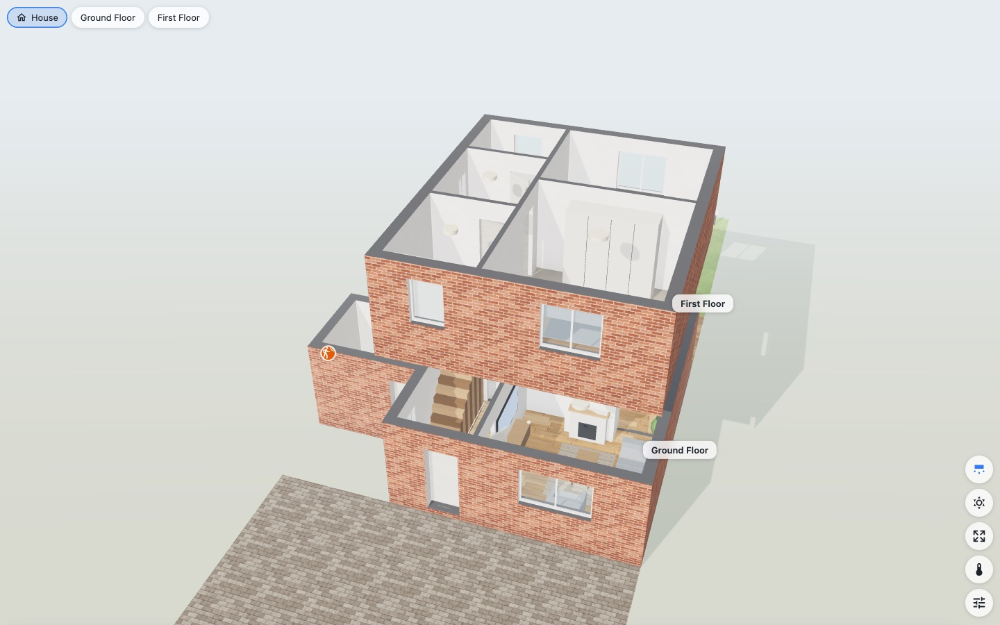

## Install

You need Home Assistant 2025.1 or later and [HACS](https://hacs.xyz).

1. HACS → ⋮ → **Custom repositories** → add `https://github.com/virtumaps/virtuhome` as
   **Integration**.
2. Find **VirtuHome** in HACS, download it, and restart Home Assistant.
3. Settings → Devices & services → **Add integration** → **VirtuHome**. One Home Assistant has one
   VirtuHome.
4. Reload the page in your browser. **VirtuHome** is now in the sidebar, and the VirtuHome card is
   in your dashboards' card picker.
5. Open **VirtuHome** in the sidebar. A new home shows **Let's get your home in**: pick **Trace a
   floor plan picture**, **Start from a house type**, **Import a scan or plan** or **Draw it
   myself**, and the editor opens on that step
   (see [Get your home in](#get-your-home-in)). People who aren't administrators see who can set
   it up.

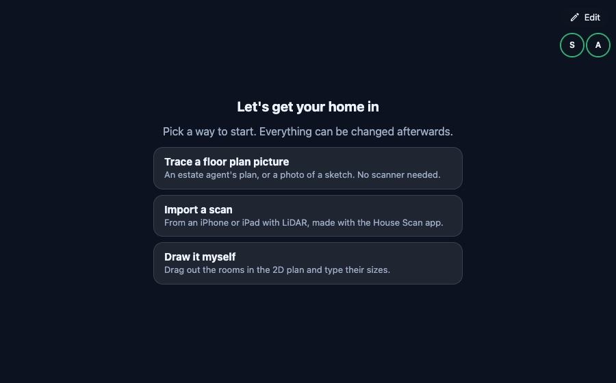

Everyone can open VirtuHome in the sidebar. Only administrators see **Edit**, and only there, not on
dashboard cards.

**Updating:** HACS shows when a new version is out. Download it, restart Home Assistant and reload
the page. Your plan stays as it is.

## Find your way around

The same view is in the sidebar and in every VirtuHome card.

**Top bar**
- **House** shows every storey; a button for each floor shows that floor alone.
- The alarm chip (**Disarmed**, **Armed home**, **Armed away**…) shows your alarm panel. Tap it for
  its dialog.
- **Edit** (sidebar only, administrators only) opens the editor. A red dot on it means
  [Check my setup](#troubleshooting) found something that doesn't work.

**Under the top bar**
- A red banner when something needs you: a leak, smoke, gas. Tap it for the sensor's dialog.
- What the solar panels make, when the house has them. Tap it for the energy sheet (see
  [Energy](#energy-and-car-charging)).
- **N on**: how many lights are on, on the floor shown or in the whole house. Tap it to turn them
  off.
- Who is home, as pictures or initials (pointing at one names the room they are in, when VirtuHome
  knows it). Tap one for that person's dialog.

**Buttons on the right**, top to bottom (extensions add theirs above these):

| Button | What it does |
|---|---|
| **Walls** | Steps through smart cutaway (walls between you and a room slide away), low, and full height. Its picture shows the mode |
| **Roof** | Only when the house has a roof: takes the roofs off to look in from above, or puts them back. Each device remembers its own choice |
| **Day / night** | Switches between the day and night looks. Normally the look follows the sun, and the picture fades from one to the other |
| **Sun and weather** | Opens the [sun and weather panel](#sun-and-weather) |
| **Show all** | Fits the whole view on the screen |
| **Temperature map** | Colours the rooms by their temperature: blue is cold, red is warm |
| **Graphics** | Picks the graphics on this device (below) |

**Room labels**
- Under each room's name: its temperature and humidity, and on the driveway the car's charge.
- A room with a thermostat or radiator valve shows what it reads and its setpoint, **20.5° → 21°**
  (the warmest setpoint if it has several), in orange while it heats. Tap the numbers for the
  thermostat's dialog; tap the room's name to open the room.
- While a room heats it glows softly warm (blue while its air conditioner cools). With one thermostat
  for the whole home, as most homes have, every room glows while the heating is on.
- Someone in the room: their picture or initials sit over its name (see
  [People in their rooms](#people-in-their-rooms)), and the room glows softly amber, as it does
  while a motion or presence sensor in it is on. Tap a face for that person's dialog. In the house
  view, faces float over the rooms they are in.

**Gestures**
- **Tap a lamp or a device** to switch it. Things that can't be switched open their dialog instead.
- **Long-press** a lamp or a device for its Home Assistant dialog.
- **Tap a room** to open it: in the house view this goes to its floor first. A sheet shows the
  room's temperature, who is here and its devices, with **All lights on** / **All lights off**.
- **Double-tap a room** to switch all its lights.
- **Double-tap empty space** to go back to the whole house.

**Graphics** (the sliders button, under **Graphics on this device**):

| Level | Look | For |
|---|---|---|
| **Automatic** | Picks a level for the device, and steps down if turning the view gets slow | most devices |
| **Tablet** | Fastest, for wall tablets | Fire tablets, old phones |
| **Standard** | Clean model look | phones, older laptops |
| **Realistic** | Textures, sunlight and shadows, the weather | computers, recent iPads |
| **Ultra** | Adds soft shading and glow; needs a strong GPU | gaming computers |

A level picked here is for this device only, and wins over the card's `quality`.

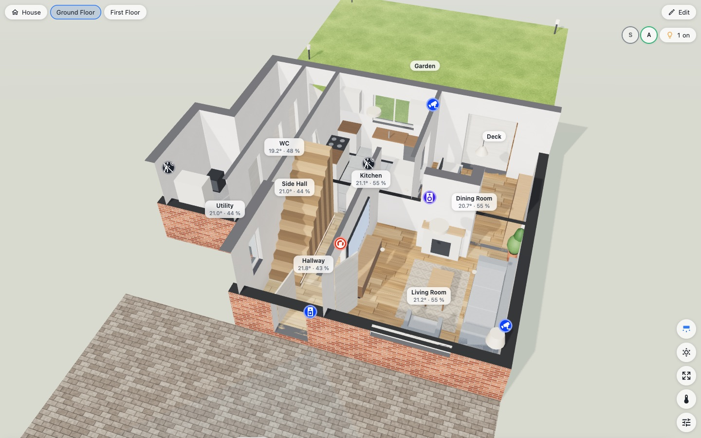

## Get your home in

There are five ways, and they mix: start from a house type, scan it, draw it in the 2D plan, trace
an estate agent's floor plan, or import it from another program. Everything here is in **Edit**.

### Getting started

Until a new home is set up, Edit → **Home** starts with **Getting started**: the steps left, each
with a button that does it or goes to where it is done.

- **Get your home in**: **Trace a picture**, **House type**, **Import a scan or plan…** or **Draw
  rooms**. Done once there is a room.
- **Link the rooms to areas**: done when every room is linked to a Home Assistant area, or no area
  is left for the rest. **Rooms** opens the Rooms tab.
- **Place your devices**: **Place devices automatically** (Smart Setup). Done once a device is in
  the plan.
- **Set north**: done once north is turned; if the top of the plan really faces north, tap
  **It's right**.
- **Put the house on a dashboard**: done once a dashboard has the VirtuHome card, or tap **Done**.
- **Set up a wall tablet (optional)**: **How** opens [Wall tablets](#wall-tablets); tap **Done**
  when it's up.

Tap a ticked step's tick to untick it. **Hide this list** puts it away, and **Show getting
started** brings it back until everything is done. Like any change, ticks are kept when you
**Save**.

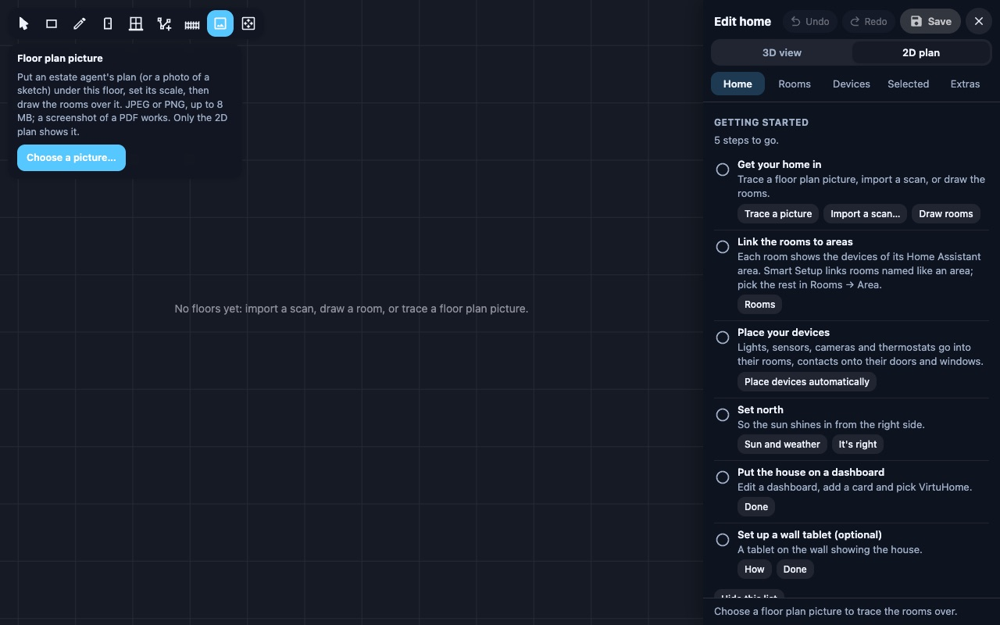

### Start from a house type

Most homes are one of a handful of layouts. A house type gives you a whole home in a minute: its
storeys, rooms named like Home Assistant's usual areas (Living Room, Kitchen, Hallway, Landing,
Bedroom 1…), doors, windows, stairs, a garden and a roof. Then you drag the walls to fit.

1. Edit → **Home** → **Start from a house type…** (on a new home: **Start from a house type**, or
   **House type** in Getting started).
2. Pick the one most like your home: **Two-bed mid-terrace**, **Three-bed semi-detached**,
   **Four-bed detached**, **Two-bed bungalow**, **Two-bed flat** or **Open-plan single storey**.
3. **Fit to my home**: type your home's outside **Width** and **Depth** in metres, as an estate
   agent's listing gives them. The rooms, garden and roof stretch with the walls; doors, windows and
   stairs keep their size and stay on their walls. **Mirror left to right** turns it the other way
   round; for the semi, pick whether it **Joins next door on the** **Left** or **Right**.
4. **Use this house type**. If the plan already has rooms, it asks before replacing them.

Smart Setup then runs by itself: storeys are linked to Home Assistant's floors, rooms to the areas
named like them, and devices go into their rooms (see [Smart Setup](#smart-setup)). What it did is
listed in the Home tab, and one **Undo** takes it all back. Next, open the **2D plan** and drag the
walls to your rooms' sizes, or put your floor plan picture under it to drag them to (see [Trace a
floor plan picture](#trace-a-floor-plan-picture)).

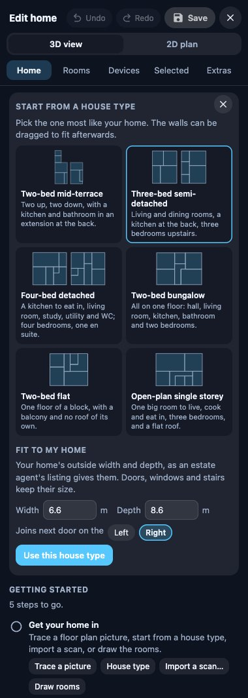

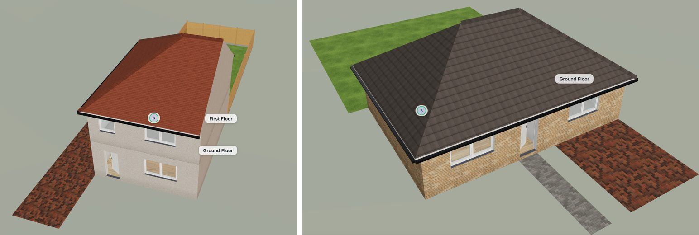

### Scan it (iPhone or iPad with LiDAR)

VirtuHome imports Apple RoomPlan scans as JSON. VirtuMaps' own **House Scan** app scans a whole
home room by room and adds room names and decoration; it is used on VirtuMaps installations and is
not in the App Store yet. Any app that saves RoomPlan's JSON works too.

While scanning with House Scan:
- Walk each room slowly, and hold decoration (plants, pictures, mirrors, gym kit) in view for a
  second, or point the crosshair at it and tap **Tag item** (best for dumbbells, mirrors and rugs).
- Allow the location: the app notes which way the phone's compass points, so the plan faces north
  from the start.

To import: Edit → **Home** → **Import** → **Import a scan or plan…**, and choose the scan's files together:
`house.json`, `manifest.json` (room names) and `detections.json` (decoration). Rooms, doors,
windows, furniture and decor come from the scan, with the walls straightened. Importing replaces the
plan you have, after asking.

Then go on to [Place your devices](#place-your-devices).

### Import from another program

Edit → **Home** → **Import** → **Import a scan or plan…** also takes plan files from other
programs:

- **Sweet Home 3D** (`.sh3d` files saved by version 5.3 or later; open an older one in Sweet Home 3D
  and save it again). Each level becomes a floor. Rooms drawn along the inner faces of their walls
  move out to the middle of the walls, and walls on no room's edge stay as walls of their own, curved
  ones in short straight pieces. Doors and windows keep their width, height, sill and hinge side,
  and belong to the room they open into. Furniture and lights become the closest built-in pieces,
  and north comes from its compass. Colours, textures, labels and dimension lines stay behind.
- **The simple plan format** (`.json`): rooms as corner lists, doors and windows by a point on a
  room's edge, furniture by type. Write it by hand or with a script, or let an AI chat read your
  floor plan picture: see [the format, with a prompt to copy](import-format.md).

Rooms come in with their outlines along the middle of the walls, doors and windows go onto their
room's edge, and furniture becomes the closest built-in piece; anything without a match comes in as
a plain box of its size. Smart Setup then places your devices, and a list says what came in and
what was left out.

Importing replaces the whole plan, after asking. Until you save, **Undo** brings your plan back (or
close the editor and **Discard**); after saving, the plan from before the import is in **Restore
points**.

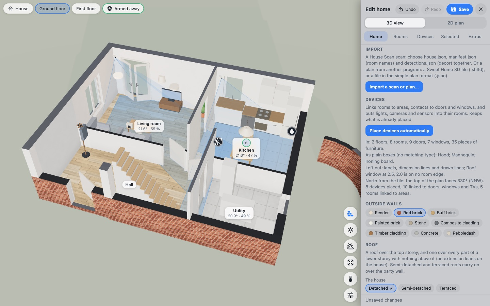

### Draw it in the 2D plan

Edit → **2D plan** shows the plan from above with every wall measured. The tools along the top say
what they do when you point at them:

- **Select and move**: select something, then drag it (furniture, devices, doors, windows, a room's
  corners and walls).
- **New room: drag a rectangle**
- **New room: click its corners, then the first one again** (or press Enter)
- **Door: click on a wall**, then slide it along. **Window: click on a wall** works the same.
- **Corner: click on an edge where it goes, drag to place it** (rooms and garden areas)
- **Fence: click its corners, then the last one again** (or press Enter)
- **Floor plan image: trace the rooms over an estate agent's plan** (next section)
- **Fit to view** shows the whole floor.

- **Click a measurement** to type the exact length.
- Corners and walls snap to the grid and line up with other corners.
- Furniture, devices, doors and windows move only once they are selected, so nothing moves by
  mistake. Turn furniture with its handle.
- Keys: arrows nudge the selected piece by 1 cm (with Shift, 10 cm), **R** turns it (Shift+R the
  other way), **Delete** removes it, **Esc** cancels drawing.
- With more than one storey, buttons with the floors' names switch between them.

Name the rooms and link them to Home Assistant areas in Edit → **Rooms** (each room has a name box
and **Area**). **Add a room** there puts a 3 × 3 m room beside the house.

For an upstairs, [add a floor](#storeys): the floor below shows faintly in the 2D plan, to draw the
new floor's rooms over.

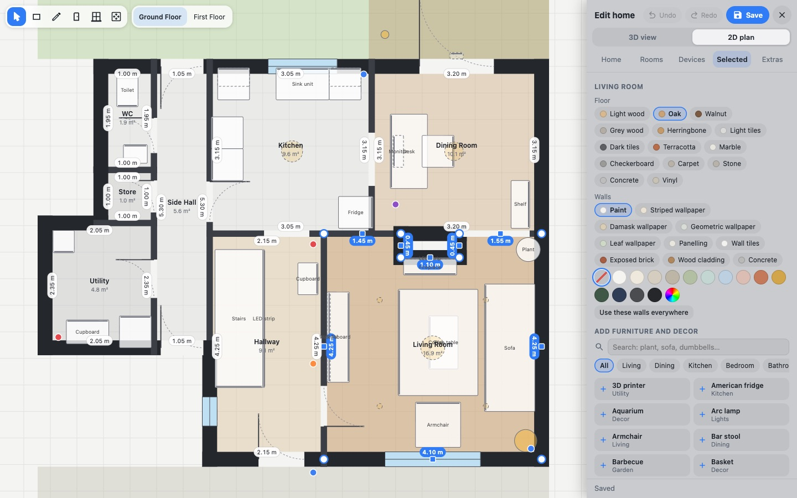

### Trace a floor plan picture

No LiDAR phone? Almost every home has an estate agent's floor plan.

1. Edit → **2D plan** → the **Floor plan image** tool → **Choose a picture…** (JPEG or PNG up to
   8 MB; a screenshot of a PDF works, and so does a photo of a sketch).
2. Click both ends of a wall you know the length of (an outside wall, or a room's width from the
   plan's labels), type its real length (`3.45`, `345 cm` or `11'4"`) and press Enter.
3. **Find the rooms** looks for the walls in the picture and shows the rooms it finds over it, with
   their doors and windows. The rooms it is sure of are ticked; tap a room's tick to keep it or leave
   it out (rooms over ones you have already drawn start unticked). **Add these rooms** puts the ticked
   ones on the plan as Room 1, Room 2…, with their doors and windows, and one **Undo** takes them all
   away again; **Cancel** adds nothing.
4. Draw any rooms it missed with the room tools, then name the rooms and link them to areas as usual.

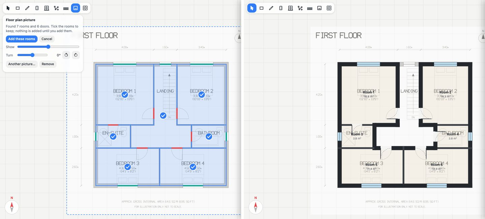

**Find the rooms** needs the scale set first. It works in your browser, so the picture goes nowhere,
and it does best on a clear plan with solid walls. Room names, measurements and furniture are left
out, a gap in a wall up to 3 m wide is taken for a door, window or opening, and wider gaps leave
rooms open to each other. Rooms come out along the middle of their walls, like rooms you draw.

Drag the picture to move it. Its panel fades it, turns it (also a quarter turn at a time), sets the
scale again, takes **Another picture…** or removes it. Each floor has its own picture: pick the floor
with the buttons at the top of the 2D plan. Only the 2D plan shows the picture. It is
kept in Home Assistant (`.virtuhome/backgrounds`, for signed-in users only) and deleted when you
remove it and save.

### Storeys

Edit → **Home** → **Floors** lists each storey: its name, the Home Assistant floor it belongs to
(**HA floor**), its **Level (m)** above the ground floor, its **Height**, and its **Outside** walls
(**Same as the house** or its own finish).

- **Add a floor** puts a new storey on top, as high as the one below, linked to the Home Assistant
  floor of its level when there is one. VirtuHome shows it, ready to draw its rooms in the 2D plan.
- The bin beside a floor's name removes it, with everything on it, after asking. The other floors
  keep their levels.
- A house that already has a roof: once the new floor's rooms are drawn, tap the roof and set
  **Sits on** to the new floor. The roof moves up with everything on it.

### Saving and undoing

- **Undo** and **Redo** are in the editor's header (or Ctrl/Cmd+Z and Ctrl/Cmd+Shift+Z).
- **Save** writes the plan to Home Assistant. Closing with changes asks first (**Discard**).
- If someone else saved meanwhile, VirtuHome asks before saving over it (**Save mine**).
- **Restore points:** every save keeps the version before it; the last 20 are in Edit → **Home** →
  **Restore points** (**Restore**).
- **Plan file:** Edit → **Home** → **Download** saves the plan as a file; **Load…** replaces the plan
  with one. The plan also goes into Home Assistant's own backups.

## Place your devices

### Smart Setup

Edit → **Home** → **Devices** → **Place devices automatically**:
- links storeys to Home Assistant floors (by level) and rooms to areas (by name), so name the rooms
  as your areas, or link them in **Rooms** first;
- attaches door and window contacts, curtains and blinds to the doors and windows of their room,
  and a TV's media player to the TV;
- gives lights, cameras, motion sensors, thermostats, plugs and speakers a sensible spot in their
  room: ceiling lights spread over the ceiling, cameras in corners looking in, motion sensors high
  in a corner;
- puts a car charger on the house wall at the driveway, with the car in front of it.

It never moves what is already placed, so run it again after adding devices. It reports what it
did, and how many devices are in areas without a room in the plan.

### By hand

- Edit → **Devices** → **Not placed** lists the devices in linked areas that aren't in the plan yet:
  **Add** puts one in its room.
- Tap a device in 3D to select it, then drag it. **Selected** shows its **Entity**, **Mount**
  (ceiling, wall, floor or table), **Height** and **Turn**, and **Remove from plan**.
- **Cameras** show where they hang (a bullet on a bracket, a ceiling dome, a doorbell, or a camera
  on a stand) with what they see lit up to the first walls: red on motion, grey while offline. Set
  **View °** and **Reach m** if the usual view is wrong.
- **Doors and windows:** tap one, then pick its **Sensor** (it opens in 3D when the sensor does) and,
  for a window, its **Blind**.
- **Lamps and TVs** that are furniture: **Linked to** picks the light, switch or media player.
- **Thermostats and radiator valves**, and **motion and presence sensors**, count for the room you
  place them in. One you don't place counts for the rooms of its area, so the zones of an Aqara FP2
  count for the areas you gave them in Home Assistant.

### People in their rooms

VirtuHome shows who is in which room when a room tracker in Home Assistant knows it:
- **Bermuda** (its **Area** sensor for each phone, watch or tag),
- **ESPresense**, through the `mqtt_room` sensor or the ESPresense Companion's trackers,
- any other sensor or tracker whose state is the name of an area.

Both need Bluetooth proxies in the rooms (ESPHome boards, ESPresense nodes or Shelly devices). The
tracker's area finds the room linked to it, so link your rooms to their areas (Edit → **Rooms** →
**Area**).

Edit → **Home** → **People** lists everyone in Home Assistant with the tracker found for them:
Bermuda's Area sensor on the device of one of their trackers (add Bermuda's tracker to the person
under Settings → People), or a tracker named after them or their phone ("Kadir's iPhone Area" for
Kadir). Pick another where that is wrong, or **Never in a room**. **Now** under the list says where
everyone is, to check the trackers. **Show people in their rooms** turns it off, and so does the
card's `people: false`.

Someone who is away is never shown in a room, even if their tracker still names one. Room trackers
stay out of the replays of the past: a replay shows people home or away, never where they went.

## Make it look like home

Tap a room in 3D (or **Show** in **Rooms**):
- **Floor**: the finish.
- **Walls**: paint or wallpaper and a colour. **Use these walls everywhere** copies them to every
  room.
- **Add furniture and decor**: search ("plant, sofa, dumbbells…") or pick a category, then tap an
  item. **In this room** lists what is there.

Tap a piece of furniture for its **Style** (swap a sofa for a corner sofa, keeping where it stands),
**Colour**, **Upholstery**, **Width**, **Depth**, **Height**, **Above floor**, **Turn** and mirror,
**Duplicate** and **Remove**. Stairs also have a **Balustrade**.

Tap a door or window to make it a **Door**, **Window**, **Opening** or **Garage door**, and to set
its **Style**, **Frame** or **Finish**, colour, **Plain glass** or **Glazing bars**, size (**Width**,
**Height**, **Sill**, **From corner**), which way it **Opens**, and **Flip hinge**. **Same style on
every door** (or window) copies the look to all of them.

The outside walls are in Edit → **Home** → **Outside walls** (brick, render, stone, cladding…), and
per storey under **Floors**.

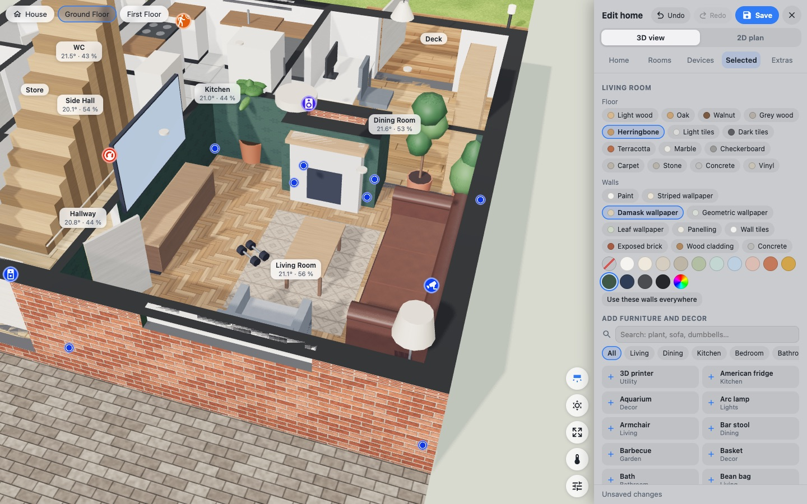

## Outside: garden, fences and the roof

### Garden

Edit → **Rooms** → **Add back garden** or **Add front area** adds an area as wide as the house;
**Add a patio** and **Add a deck** add one in the back garden. Tap an area for its **Name**,
**Ground** (Lawn, Patio, Deck, Path, Driveway, Flower bed or Gravel) and **Area** (its lights light
it up at night). Drag its blue corners to shape it; drag a + from the middle of an edge to add a
corner. Type a rectangle's **Size m**, or a round area's **Across m**. **Duplicate** copies it.

**Patios, paths and driveways:**
- **Laid with**: Indian sandstone, Porcelain, Concrete slabs, Slate, Granite, Limestone, Travertine,
  Block paving, Clay pavers, Granite setts, Crazy paving, Resin bound or Tarmac, in its **Colour**.
- **Pattern** (Random, Grid, Staggered, Third offset, Herringbone or Basketweave) and **Size (mm)**,
  as the material comes.
- **Joints**: their colour. **Runs**: **Along**, **Diagonal** or **Across** the longest edge, or type
  an angle.
- **Border**: a course of Granite setts, Block paving, Clay pavers, Porcelain or Indian sandstone
  round the edge, and its colour.
- A gravel area has the colour of its **Stones**.

**Decks:** **Boards** (Softwood, Cedar, Hardwood or Composite) and their **Colour**, **Boards mm**,
**Runs**, and **Picture frame: boards along the edges**.

**Raised patios and decks:** a patio's **Raised (m)** or a deck's **Height (m)** (**Level with the
floor** is the usual for a deck). A raised patio's **Sides** are Brick, Stone, Render or Sleepers.
Under **Steps down**, tap **Steps** on any side away from the house and type their width. A
**Railing** (Spindles, Glass, Railings, Post and rail, Slatted or Picket) runs round the open sides,
with a gap at the steps.

On a lawn, **Add to this garden** adds a **Patio**, **Round patio**, **Deck** or **Path** in the
middle of it, **Draw a patio** drags one out in the 2D plan, and the list below adds garden
furniture, plants, pergolas, sheds and planters.

### Pergolas, sheds and planters

Add them from a lawn's **Add to this garden**, or from **Garden** in any room's list. Tap one to swap
its **Style** for another of its kind, and set its **Colour**, size and **Turn**:
- **Pergolas** (Pergola, Louvred pergola, Pergola on a wall, Gazebo, Garden arch, Arbour): **Top** is
  Open, Slats, Glass roof, Canvas sail, Climbing plants or Louvres, as the style has them; a gazebo
  has a **Roof**.
- **Sheds** (Apex shed, Reverse apex shed, Pent shed, Summerhouse, Log cabin, Garden office, Metal
  shed, Greenhouse): **Roof** (Felt, Shingles, Corrugated sheet, Rubber (EPDM) or Green roof
  (sedum)), **Door** (Left, Middle, Right or Double doors), **Windows**, and the **Trim** colour of
  the corner boards, fascias and frames, as the style has them.
- **Planters** (Trough planter, Raised bed, Cube planter, Round planter, Tall planter, Tiered
  planter): **Made of** (Timber, Sleepers, Painted wood, Corten steel, Galvanised steel, Fibreclay,
  Terracotta, Brick, Stone or Rattan) and **Planting** (Flowers, Shrubs, Grasses, Lavender, Herbs,
  Vegetables, Topiary ball, Small tree or Just soil).

### Fences and garden walls

- **Fence round it** on a garden area fences every edge that isn't along the house.
- **Draw a fence** (Edit → **Rooms**) opens the 2D plan's fence tool.
- Tap a fence for its **Style** (16 designs from closeboard to railings, spindles, glass and brick
  walls),
  height, **Colour**, **Posts**, the gravel board and a trellis on top, and its gates: **Add a gate**
  or **Add a driveway gate**, each with its place and width, single or **Double**.

### The roof

Edit → **Home** → **Roof** works the roofs out from the plan:
1. **The house**: **Detached**, **Semi-detached** (and which side it is **Joined on the**) or
   **Terraced**. A ✓ marks what the walls suggest.
2. **Main roof**: **Hipped**, **Gable**, **Half-hipped**, **Dutch gable**, **Mansard**,
   **Gambrel**, **Pyramid**, **M-shaped**, **Flat**, **Butterfly** or **Lean-to** (point at one for
   what it looks like), and its **Covering**.
3. **Add the roof**: a roof over the top storey, and a lean-to (or flat roof) over each lower part
   that stands against the house.

Tap a roof in 3D for the storey it **Sits on**, its shape, **Pitch °**, which ends are **Joined
next door**, **Covering** and colour, **Fascias and soffits**, **Eaves out**, **Eaves at**,
**Length**, **Span** and **Turn**.
Drag its blue corners to size it. **Add a roof** adds one more; **Start again** takes them all off.

**Add on the roof:** **Solar panels**, **Roof window**, **Chimney**, and a **Dormer** (or on a flat
roof a **Roof lantern**). Drag them along the roof once selected.

**Solar panels** go on the sunniest slope, as many as fit. Tap them to set:
- **Across** and **Up**: how many panels; **Portrait** or **Landscape**; **All black** or **Blue**.
- **Panel size (mm)**: pick a common size or type **Long** and **Short** from the label on the back
  of a panel. A new size changes every array of the same panels, and new arrays take the size and
  power of those already on the roof.
- **Each (W)**: each panel's peak power. On a flat roof, **Tilt °** puts them on frames.
- **Shines with**: the power sensor of their string (PV1, PV2…), so they shine with what it makes.
- **Fill the slope**: as many as fit.

## Energy and car charging

When Home Assistant's energy dashboard has solar, a battery or the grid, VirtuHome shows what the
panels make in the corner. Tap it for the energy sheet: the power flowing between solar, battery,
grid and the house, the price now, and today's totals.

Edit → **Home** → **Energy** shows which sensors were found. Pick another only where one is wrong:
**Solar**, **House**, **Battery in**, **Battery out**, **Battery level**, **Grid import**, **Grid
export**, **Price to buy**, **Price to sell**. **Panels' peak (kW)** sets how brightly placed panels
shine (otherwise the best output seen). **Show solar, battery and grid** hides it all.

**Car charging:** Ohme, Zappi, Hypervolt, Pod Point, Wallbox, Easee and OCPP chargers are found by
themselves. The energy sheet shows the car's battery, what it charges to and by when, its charge
modes and **Approve charge**. The charger on the driveway lights up while it charges, and the car is
on the drive while it is plugged in or its tracker says it is home: tap the car for **Shown**
(**Always**, **While plugged in**, or a tracker) and **Shape it like the** (your car). **Charger**
and **Car battery** under **Car charging** fix wrong sensors; **Show the car charger** hides it.

## Sun and weather

**Set north first:** Edit → **Home** → **Sun and weather**. Drag the N on the compass to where
north is, type the bearing the top of the plan **Faces**, or tap **Line up with the map**. That
sends Home Assistant's home location to a public OpenStreetMap server for the outline of your
building, turns the plan to match it, and offers the other ways it fits if your house faces
otherwise. The 2D plan also has a north arrow to drag.

Pick the **Weather** entity there too, or untick **Show the weather: clouds, rain, snow, fog and
wind**. With no weather entity, add Met.no (Settings → Devices & services).

The **Sun and weather** button in the view opens a panel to see the house at any **Date** (**Today**,
**Midwinter**, **Spring**, **Midsummer**, **Autumn**) and **Time** (**Now**, **Sunrise**, **Noon**,
**Sunset**, or play the day through), in any weather (**Live**, **Clear**, **Cloudy**, **Rain**,
**Storm**, **Snow**, **Fog**). Shadows, clouds and rain show with **Realistic** graphics. Close the
panel to go back to live.

**Dusk and dawn:** while the look follows the sun, **Realistic** and **Ultra** go from day to night
gradually: the low sun turns golden, the sky goes rose and then blue, the moonlight comes up and
the lamps that are on light the house more and more, until it is dark about 9° after sunset (and
the same way back at dawn). Clouds keep the colours muted. With **Tablet** and **Standard** the sky
behind the house takes the colours of sunset, and the house fades from the day look to the night
look at sunset.

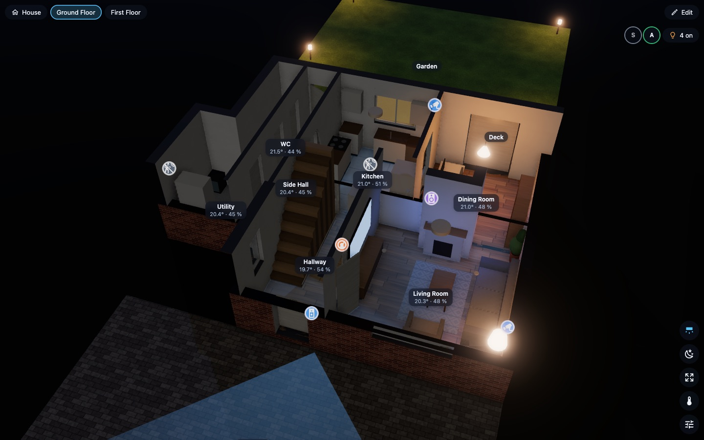

## Wall tablets

VirtuHome is built for wall tablets: it draws nothing while nothing changes.

**The dashboard:** make a dashboard view of the **Panel** type with only the VirtuHome card, so it
fills the screen (or set `fill: true` on the card). Set `floor:` to open on one floor.

**Graphics:** on the tablet, pick **Tablet** under **Graphics**, or set `quality: low` on the card.
A Fire HD 8 runs well at **Tablet** and **Standard**; **Realistic** and above are too heavy for it.

**Which app:**
- **Amazon Fire tablets:** the Home Assistant Companion app from the Amazon Appstore, or Fully Kiosk
  Browser.
- **Android tablets:** the Companion app, or Fully Kiosk Browser.
- **iPad:** the Companion app. Guided Access (Settings → Accessibility) keeps it on the app.

**Kiosk tips**
- Open the tablet's dashboard at start, keep the screen on, and hide the system bars (Fully Kiosk
  has settings for each).
- A tablet that shows **VirtuHome** from the sidebar rather than a dashboard: sign it in as a Home
  Assistant user that isn't an administrator, so **Edit** isn't there to tap.
- The roof button and the graphics level are kept per device, so the tablet can differ from your
  phone.
- The **Wall Tablet** extension adds a doorbell camera takeover, a return to the start view when
  nobody touches it, a slow turn as a screensaver, and night dimming (see
  [Extensions](#extensions-and-licence-keys)).

## The card and its options

Add the card from the dashboard's card picker (**VirtuHome**) and set it up in its visual editor,
or in YAML:

```yaml
type: custom:virtuhome-card
floor: ground
theme: auto
walls: smart
quality: auto
height: 440
```

| Option | Visual editor | Values | Default |
|---|---|---|---|
| `floor` | Open on floor | a floor's name, id or number | the whole house |
| `theme` | Look | `auto` (day or night by the sun), `day`, `night` | `auto` |
| `walls` | Walls | `smart` (cutaway), `low`, `full` | `smart` |
| `quality` | Graphics | `auto`, `low` (Tablet), `medium` (Standard), `high` (Realistic), `ultra` | `auto` |
| `height` | Height | pixels; ignored in a panel view or with `fill` | `440` |
| `room_panel` | Tap a room to open it | `true` / `false` | `true` |
| `floor_chips` | Floor buttons | `true` / `false` | `true` |
| `fill` | Fill the screen | `true` / `false` | `false` |
| `people` | Show who is home, and in which room | `true` / `false` | `true` |
| `energy` | Show solar, battery and grid | `true` / `false` | `true` |
| `roof` | Show the roofs (each device can change it) | `true` / `false` | `true` |
| `alarm` | Alarm panel in the top bar | an `alarm_control_panel` entity, or `none` | the first alarm panel |
| `stats` | (YAML only) | `true` shows the frame rate and graphics level in a corner, for reporting a slow device | `false` |

Extensions add their own sections to the visual editor (below).

## Extensions and licence keys

VirtuHome is free and open source. Extensions add more, and are currently available to VirtuMaps
installation clients.

**Activate a key:** Edit → **Extras** → type the **Licence key** → **Activate** → **Reload now**.
The licence shows **Active**, the extensions it unlocks and their versions. **Check for updates**
fetches new versions; **Remove licence** frees the key for another Home Assistant. **Available
extensions** lists what there is.

**What is sent:** opening **Extras** asks the VirtuMaps licence server for the list of extensions.
Activating a key sends the key and an anonymous code for this Home Assistant, nothing that names
your home. The licence is then renewed about once a day while Home Assistant is online. Extensions are checked, stored in Home Assistant and keep working offline.

| Extension | What it adds | Card options (visual editor section) |
|---|---|---|
| **Wall Tablet** | A camera (the doorbell) takes over the screen while a sensor is on; back to the start view when idle; a slow turn as a screensaver; dimming at night | **Wall tablet**: Camera that takes over the view (`popup_camera`), while any of these is on (`popup_triggers`), and this long after (`popup_hold`, seconds), Back to the start view after (`idle_return`, seconds), Slowly turn the house while idle (`idle_orbit`), Dim at night (`night_dim`: `sun`, or a time range like `22:00-06:30`) |
| **Energy** | The **Power map** button colours the rooms by what they use now; the energy sheet lists the biggest users, what isn't measured, and each device's energy today. **Solar on the roof** → **Work it out** scores each part of the roof for solar panels through the year, with the shade of chimneys, dormers, taller walls and trees, and estimates what placed panels make | **Energy**: Start with rooms coloured by their power (`power_map`), Power sensors to leave out (`power_exclude`) |
| **Security** | **What happened (timeline)**: the last days played back on the house (doors, windows, motion, cameras, the doorbell, the alarm, locks, people home or away), a list of events, and **While you were out** when someone comes home. **Camera clips**: recordings in Home Assistant's media, in folders named after a camera (such as `/media/front_door/<date>/<time>_motion.mp4`), play beside the house as it was at that moment | **Security**: Timeline button (`timeline`), Days the timeline goes back (`timeline_days`), Sensors to leave out of the timeline (`timeline_exclude`), When someone comes home, show what happened while everyone was out (`away_report`), once everyone was out for at least (`away_minutes`), Camera clips (`clips`), Media folders of camera recordings (`clip_folders`) |

## FAQ

**Do I need an iPhone with LiDAR?** No. Trace an estate agent's floor plan, draw the rooms in the 2D
plan floor by floor, or [import a plan](#import-from-another-program). A scan is quicker and brings
furniture and decoration.

**Does VirtuHome send my data anywhere?** No. It runs inside Home Assistant. Only these go out, and
only when you use them: **Line up with the map** (your home's location, to OpenStreetMap), and the
**Extras** tab and licence keys (see [Extensions](#extensions-and-licence-keys)).

**Will it slow down my tablet?** It draws nothing while nothing changes, and each floor is one or two
draw calls. On slow tablets pick **Tablet** graphics.

**Which tablets and browsers work?** Anything with WebGL 2 and a browser at least as new as
**Chrome 87** or **Safari 15**. On Android that includes the Android System WebView, which Fully Kiosk
and the Home Assistant app use (on a Fire tablet, update it in the Amazon Appstore if it is older). On
iPhone and iPad it means iOS 15 or later, which runs from the iPad Air 2 and the 5th-generation iPad
on. A Fire HD 8 (2022) runs it well with **Tablet** graphics.

**Where is my plan kept?** In Home Assistant (`.storage/virtuhome.plan`, with the last 20 restore
points in `.storage/virtuhome.history`), so Home Assistant's backups include it.

**Can I have more than one home?** One Home Assistant has one VirtuHome plan.

**Does it work in feet and inches?** Measurements are in metres. The floor plan picture's scale takes
feet and inches (`11'4"`).

**Is it free?** Yes, under the GPL-3.0 licence. Extensions are separate.

## Troubleshooting

**Check my setup**: Edit → **Home** starts with it. It lists what stops VirtuHome working as it
should, with a fix where there is a safe one. Nothing changes until you press a fix, and
**Check again** asks Home Assistant again.
- **Linked entities**: links to entities Home Assistant no longer has (see below).
- **Rooms and areas**: rooms not linked to an area, or linked to one that is gone. **Link rooms by
  name** links them to the areas named like them; **Open Rooms** to pick by hand.
- **Areas without a room**: areas with devices but no room in the plan. **Add a room** puts one,
  named and linked like the area, beside the house, to move where it belongs.
- **Dashboard card**: the card missing from your dashboards' resources, or an old version there
  (**Add it again**), or this page still running an older VirtuHome than the one installed
  (**Reload**). Just after Home Assistant restarts it says **Checking…** until Home Assistant has
  finished starting.
- **Graphics on this device**: Automatic stepped down because turning the view was slow (**Try
  again**), or the browser draws without the graphics card.
- **Extensions and licence**: an extension that needs a newer VirtuHome, or a licence that has
  expired or couldn't renew (**Renew now**).
- **Plan repairs**: what VirtuHome put right while loading the plan; **Save** keeps it.

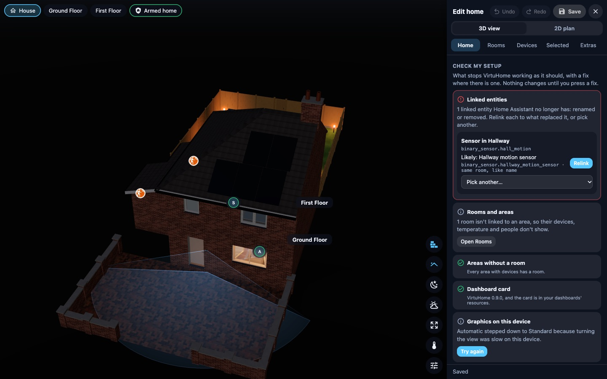

**"Custom element doesn't exist: virtuhome-card"**, or the card stays empty
- Check the integration is added (Settings → Devices & services → VirtuHome), then reload the page.
- Dashboards with resources in YAML mode: add `/virtuhome_static/virtuhome-loader.js` as a
  `module` resource yourself. In storage mode VirtuHome adds it.
- After an update, reload the page, or clear the browser's cache on a tablet.

**"Something went wrong drawing the house"**: the card or panel shows this instead of the house when
it can't draw it.
- **Reload** loads the page again.
- **Copy details** copies what went wrong: the VirtuHome version, the graphics level, the browser
  and the error. Names of rooms, areas, devices and people, entity ids and web addresses are taken
  out. Paste it into an [issue](https://github.com/virtumaps/virtuhome/issues/new/choose) if it
  keeps happening.

**"VirtuHome is not set up"**: add the integration under Settings → Devices & services.

**"No home yet"**: an administrator opens **VirtuHome** in the sidebar and picks how to [get the
home in](#get-your-home-in). Dashboard cards only show the house once it is there.

**The tablet is slow**
- Pick **Tablet** under **Graphics** on that tablet (or `quality: low`).
- If it says "Switched to … graphics to keep it smooth", Automatic stepped down for you.
- Close other apps, and use a panel view with only the VirtuHome card.

**Devices are in the wrong room**
- Check the device's area in Home Assistant, and that the room is linked to that area (Edit →
  **Rooms** → **Area**).
- **Place devices automatically** never moves what is placed: select the device and drag it, or
  **Remove from plan** and run it again.

**A door or window doesn't open in 3D**: tap it in the editor and pick its **Sensor**.

**Something stopped working after a device was renamed, re-paired or replaced in Home Assistant**
- VirtuHome keeps the Home Assistant registry id of everything it links when you save, so an
  entity renamed later is followed by itself. Open **Edit** and **Save** to keep the new name in
  the plan.
- Edit → **Home** → **Check my setup** → **Linked entities** lists links to entities Home
  Assistant no longer has, with what most likely replaced each one (the same device, or a like name
  in the same room). **Relink** takes it and **Relink all** takes every suggestion. **Pick
  another…** links any entity of the same kind, or **Unlink** (**Remove from plan** for a device).

**Someone is in the wrong room, or in none**
- Check what their tracker says in Home Assistant: it must name an area (Bermuda's Area sensor, or a
  room of ESPresense named like the area).
- Link that room to the area (Edit → **Rooms** → **Area**).
- Pick the right tracker for them in Edit → **Home** → **People**.

**Shadows fall the wrong way**: set north (Edit → **Home** → **Sun and weather**).

**No solar, battery or grid in the corner**: set them up in Home Assistant's energy dashboard, or
pick the sensors in Edit → **Home** → **Energy**.

**Extensions don't show after activating**: tap **Reload now**, or reload the page.

**An extension goes wrong**: the house carries on without it. Its room colours, labels, buttons and
the rest are left out.

**The house went blank for a moment**: when the browser drops the graphics (the graphics card
resets, or a tablet wakes from sleep), the house is drawn again by itself after a few seconds.

**Still stuck?** Ask in [Discussions →
Q&A](https://github.com/virtumaps/virtuhome/discussions/categories/q-a). To report something that
doesn't work, a device to support, a scan that came in wrong or a slow device, open an
[issue](https://github.com/virtumaps/virtuhome/issues/new/choose) with its form, and attach the
diagnostics file: Settings → Devices & services → VirtuHome → ⋮ → **Download diagnostics**. It holds
the versions, the plan's size and what each floor counts, how the card reaches your dashboards and
which extensions are loaded, and how many things each check of **Check my setup** found when an
administrator last opened VirtuHome. It has no room, device or entity names, and no licence key or
token.
